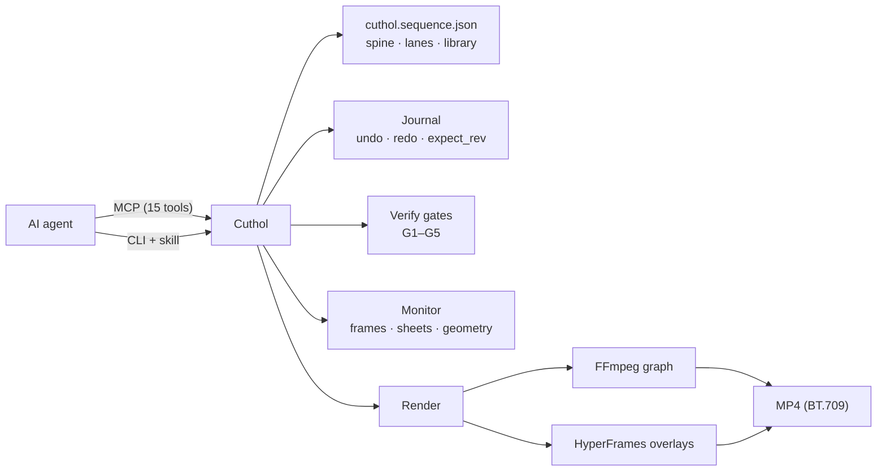

<p align="center">
  <picture>
    <source media="(prefers-color-scheme: dark)" srcset="assets/brand/cuthol-lockup-dark.png">
    
  </picture>
</p>

<h3 align="center">The video editor built for AI agents.</h3>

<p align="center">
  Your agent cuts, captions, mixes and renders video on your machine — through a CLI, an MCP server or a skill —<br>
  and checks the edit by reading text, not by guessing from pixels.
</p>

<p align="center">
  <a href="LICENSE"></a>
  
  
  
  
</p>

https://github.com/user-attachments/assets/33df6847-b6dd-41b6-918d-3e2581282eba

<p align="center"><sub>From <code>npm install</code> to a finished edit: setup, one request to the agent, Cuthol Live, a note on the picture.</sub></p>

<p align="center">
  <a href="https://cuthol.com">Website</a> ·
  <a href="#install">Install</a> ·
  <a href="#what-you-can-ask">What you can ask</a> ·
  <a href="#cuthol-live">Cuthol Live</a> ·
  <a href="#why-cuthol">Why Cuthol</a> ·
  <a href="#features">Features</a> ·
  <a href="#how-it-works">How it works</a> ·
  <a href="skills/cuthol/SKILL.md">Agent skills</a> ·
  <a href="llms.txt">llms.txt</a> ·
  <a href="src/ARCHITECTURE.md">Architecture</a>
</p>

---

**Why Cuthol if you already have HyperFrames?** HyperFrames turns HTML into video; it is the motion-graphics engine Cuthol is built on. Cuthol is the editor around it:

- **Your footage stays real video.** Camera files, screen recordings and audio are cut, retimed, graded and mixed in FFmpeg, not re-rendered through a browser.
- **The edit is text an agent can read.** One project file with a spine, lanes, words, beats and diagnostics; every change is a typed command that is checked and can be undone.
- **Nothing to sign up for.** Everything runs on your machine; speech services are optional and replaceable.

> **New in 0.4.0** — **effects on clips and cues** with keyframes, masks, motion blur, motion layers and GLSL shaders, each checked before it can fail a render · **`cuthol explain`** for every diagnostic · **much faster commands** (text-only commands in ~0.2 s, edits on a 30-composition project 20 → 3.3 s) · a **choice of local speech engine** (Parakeet or Whisper) · cleaner filler cuts · free stage sizes and sequence tempo. [Changelog](CHANGELOG.md)

## Install

```bash
npm install -g cuthol
cuthol setup                               # shows which agent tools it found and what it would register
cuthol setup --agent claude-code --apply   # registers the MCP server and installs the skills for that tool
cuthol doctor                              # checks ffmpeg 8, a Chromium browser, HyperFrames and speech
```

Agent ids: `claude-code`, `codex`, `cursor`, `gemini-cli`, `copilot`, `opencode`, `agents` (repeat `--agent` or separate them with commas). `cuthol setup --apply` without `--agent` registers the MCP server only. No ffmpeg 8 on your machine? `cuthol setup --ffmpeg --apply` installs a pinned, checksum-verified ffmpeg 8.1 for Cuthol (Windows and Linux; on macOS `brew install ffmpeg`).

Optional, for transcription and voiceover without any API key (downloads the chosen engine once):

```bash
cuthol setup --local-speech --engine parakeet --apply   # fast, 25 European languages
cuthol setup --local-speech --engine whisper --apply    # every language, including Turkish
```

`cuthol setup` registers the MCP server with Claude Code (through the `claude` CLI), Codex, Cursor and Gemini CLI. It backs up every config file before writing, keeps everything else in it, and never replaces a different `cuthol` entry unless you pass `--force`. Start a new agent session afterwards; most clients read MCP servers only at session start.

No global install? `npx -y cuthol setup --apply` registers `npx -y cuthol mcp` instead.

`cuthol doctor` prints one line per check and a one-line fix for anything missing; `--json` returns the same as data, and the exit code is 1 when a required tool is missing.

<details>
<summary><strong>Register the MCP server by hand</strong></summary>

`cuthol setup` prints the exact entry for your machine. It is a stdio server started as `cuthol mcp` (or `npx -y cuthol mcp` without a global install).

- **Claude Code:** `claude mcp add cuthol -- cuthol mcp`
- **Codex** (`~/.codex/config.toml`):
  ```toml
  [mcp_servers.cuthol]
  command = "cuthol"
  args = ["mcp"]
  ```
- **Cursor** (`~/.cursor/mcp.json`) and **Gemini CLI** (`~/.gemini/settings.json`):
  ```json
  { "mcpServers": { "cuthol": { "command": "cuthol", "args": ["mcp"] } } }
  ```
- **Any other MCP client:** register a stdio server with the same command. If your client cannot find `cuthol` on `PATH`, use the absolute path of `node` and of `dist/cli.js` inside the global install (`npm root -g` shows the folder).
</details>

### Agent skills

Cuthol teaches your agent through skills: an entry skill, `cuthol`, that the agent reads at the start of a session, and category skills it loads only when the task needs them — `cuthol-editing`, `cuthol-speech`, `cuthol-audio`, `cuthol-color`, `cuthol-motion`, `cuthol-geometry`, `cuthol-review`, `cuthol-render` and `cuthol-extensions`.

Skills are installed only where you ask: `cuthol setup --agent <id> --apply` or `cuthol skills install --agent <id>`. Skills you edited yourself are never overwritten, and commands print a hint when the skills are missing or out of date. Start a new agent session to load them. Manage them with `cuthol skills list | install | check | remove`. Over MCP the same content is served by the `guide` tool.

**Requirements** (`cuthol doctor` checks them): Node.js ≥ 22.12, `ffmpeg` and `ffprobe` 8.x on `PATH` (`verify` and render warn with `CUTHOL-G212` on an older major), and a Chrome/Chromium that HyperFrames can launch for motion graphics. Cuthol pins **HyperFrames 0.9.15** and GSAP 3.14.2 (exact versions in `package.json`, installed with Cuthol; `cuthol doctor` checks them). Speech is optional and has three routes: keyless on your machine (`cuthol setup --local-speech --engine parakeet|whisper --apply`; Piper for voiceover), cloud with `DEEPGRAM_API_KEY` (transcription) and `ELEVENLABS_API_KEY` (voiceover) in the environment or a project `.env`, or any other service through an [extension provider](examples/extensions).

## What you can ask

Once Cuthol is connected, talk to your agent the way you would brief an editor:

- *"Cut the pauses and filler words from `talk.mp4`, caption every word and put `music.mp3` under the voice."*
- *"Turn this 16:9 recording into a 9:16 short that follows the speaker."*
- *"Make a 30-second launch video with motion graphics that hit the beat."*
- *"Speed-ramp the last clip from 1× to 3× and keep the sound in sync."*
- *"Check that no title is covered or cut off before you render the master."*
- *"Make it warmer like this reference frame, but keep the white wall white — and match the second camera to the first."*
- *"Render a transparent version of the title animation and export the timeline for Premiere."*

The agent works through typed commands, reads the result as text, looks at real preview frames when it needs to, and every change can be undone.

## Cuthol Live

Watch your agent edit, and step in when you want to. Cuthol Live is a window on your machine that follows the edit as it happens: a preview player, the timeline with every lane, the scene list and a feed of what the agent just changed.

<p align="center">
  
</p>

- **Leave notes on the picture.** Press `N`, click the frame and write what you want changed. The agent receives the note, with the frame, alongside the result of its next command, and handles it first.
- **Pause and edit yourself.** Pause the agent and split, delete, trim, duplicate, mute or undo on the timeline. When you resume, the agent gets a summary of your changes; while it works, the edit tools stay dimmed so the two of you never edit at once.
- **See the colour.** The preview shows each clip's grade exactly as it renders. Effects → Color opens before/after, waveform, parade, vectorscope and histogram for the clip you clicked, and sliders for white balance, exposure, contrast, shadows, highlights, saturation and vibrance while the agent is paused.
- **See the render.** Render stages, progress and an estimate of the time left show in the window.
- **Settings in one place.** Hardware acceleration and which graphics card encodes, render workers, the output and cache folders, which browser draws the window, and keyboard shortcuts. A setting the agent changed is marked, and a change you make is passed on to the agent.

Nothing to install. By default the agent asks once at the start of a session whether to open the window; you can also open it yourself with `cuthol live open`, or set the window mode to `on` or `off` in its settings (or `CUTHOL_LIVE=on|off`). It opens in your default browser as an app window — Chrome, Edge, Brave and other Chromium browsers; others open it as a normal window — with its own profile and no extensions. Everything runs locally.

## Why Cuthol

Most agent video tools generate video or draw it from code. Cuthol edits what you actually recorded, and gives the agent what a human editor has: a timeline, ears, eyes and a final check.

### What sets it apart

- **Real recordings, cut for real.** Long talks, screen recordings and camera files stay real video on a magnetic timeline. Pauses, fillers and false starts are cut on quiet points, never inside a kept word, and `speech verify-cleanup` re-listens to the edit to report what went missing.
- **The agent checks the edit before it renders.** Five verification gates (schema, assets, timing, stage, signal), frame previews that come from the render pipeline itself, per-frame layout measurement of every graphic, and an audio health check after the render. Problems come back as short coded diagnostics with the next command (`cuthol explain <code>`).
- **Local and keyless if you want.** Transcription and voiceover can run on your machine (Parakeet or Whisper, Piper); cloud speech is optional and replaceable. Nothing to sign up for, nothing leaves your machine unless you choose a cloud provider.
- **Works with HyperFrames, not instead of it.** HyperFrames compositions mount on lanes and receive the edit's words, beats and cuts; Cuthol does the footage, speech, mix, colour and final composite around them.
- **A person stays in the loop.** In Cuthol Live you watch the edit, leave notes on the picture and pause the agent; the finished timeline exports to Premiere, Resolve, Final Cut Pro and OpenTimelineIO.
- **Open and in your agent's tools.** MIT licensed; a CLI, an MCP server with 15 tools, and skills for Claude Code, Codex, Cursor, Gemini CLI and others.

### Built for how an agent works

Editing software is built around a person with a mouse and a timeline they can see. An agent has neither. Cuthol gives an agent the whole workspace of an editor in a form it can use:

- **Typed handles instead of clicks.** Every clip, cue and asset has a stable id (`vid_01`, `sp_01`, `cue_01`) that is never reused, so an agent never edits the wrong thing after a change.
- **Text views of the edit.** Compact lenses (overview, flow, canvas, detail), transcripts with word timings, and exact per-frame geometry of every motion-graphics element.
- **Images only where they help.** Frame previews and contact sheets come from the same pipeline as the final render: what the agent sees is what ships.
- **Nothing is lost.** An atomic journal with undo previews; verification gates before every render; results reported as short diffs.
- **Light on context.** The entry skill is about 10 KB; each category skill (6–9 KB) is loaded only when its task comes up. The MCP server exposes 15 tools whose schemas cost about 15k tokens once per session (measured).

### Cuthol and HyperFrames on the same task

One real editing job, given word for word to the same coding agent twice: once with Cuthol 0.4.0, once with HyperFrames 0.9.72 plus ffmpeg. The job: turn a 25:41 conference talk (CC BY 4.0) into a YouTube video. Remove pauses over 0.6 s, fillers and false starts without cutting inside words. Add burned-in captions that follow the speech, a title card of at most 2 s, one lower third and a looping music bed ducked under speech. Hit −14 LUFS / ≤ −1 dBTP, end on a credits line and write the kept source ranges.

| | Cuthol 0.4.0 | HyperFrames 0.9.72 + ffmpeg |
|---|---|---|
| Finished without help | yes | yes |
| Wall time | **43.3 min** | 51.4 min |
| Of which rendering | 6.0 min | 12.8 min |
| **Wall time without rendering** | **37.3 min** | 38.6 min |
| **API bill for the agent** | **$5.67** | $8.24 |
| Uncached input / cached input / output + thinking tokens | 0.39 M / 14.5 M / 0.15 M | 0.49 M / 24.1 M / 0.21 M |
| Output length | 23:41 | 22:22 |
| Loudness (target −14 ± 1 LUFS, ≤ −1 dBTP) | −14.3 / −1.6 | −14.5 / −1.4 |
| Black frames over 0.5 s | 0 | 0 |
| Delivery format (1080p25, H.264, AAC 48 kHz stereo) | ✓ | ✓ |
| Title card, lower third, credits, captions | ✓ | ✓ |
| Agent read the tool's source code | 0 times | — |

<sub>How it was measured: the same agent (Gemini 4 Neon, highest thinking level) with the same task text, isolated home folder and local-only speech recognition (no paid speech APIs). The bill uses Gemini API list prices (input $3, cached input $0.15, output $15 per million tokens) applied to the tokens each run used. Rendering counts the steps that produce video files: graphics and title renders plus final assembly and encode. One run per tool (n = 1), on a 12-thread Windows laptop.</sub>

## Features

| | |
|---|---|
| **Timeline** | A magnetic primary storyline (`spine`) plus typed parallel lanes (titles, captions, b-roll, motion graphics, voiceover, sfx, music). Cues anchor to clips and follow later trims. Long recordings with thousands of cuts and long compositions are normal use. |
| **Clip effects** | Applied in the render graph, so the source and its transcript binding stay intact: speed ramps that picture, audio and word timings all follow; brightness, contrast, saturation, white balance and `.cube`/`.3dl` LUTs (static or animated); per-clip effect chains; mirrored or stretched edge fill; cubic-bezier and step easing; transitions from extensions. |
| **Colour** | Measured, never automatic: a short text map of a clip or a reference (tones, neutral axis, colourfulness, hue sectors), editable blocks (white balance, exposure, tone, curves, wheels, HSL secondaries, saturation, named Looks) compiled to one LUT, a render-free prediction with side effects after every change, proposals toward another clip or a before/after pair, variant sheets with the untouched picture first, keyframed colour and HDR-to-SDR. |
| **Speech** | Transcription with word timings and automatic language detection; pause and filler cleanup whose cut edges sit in real silence and never eat a kept word; an optional post-cleanup check; repeated phrases and restarted sentences offered for review instead of cut blindly; word-highlighted captions; voiceover synthesis. |
| **Providers** | Deepgram and ElevenLabs are built in. Local models and other services plug in as extension providers — speech recognition, voiceover, and music/sound-effect sources searched and fetched into the library with their source and licence recorded. Secrets stay in the environment and are never written to the project. Keyless transcription and voiceover on your machine: `cuthol setup --local-speech --apply`. |
| **Mix** | Loudness normalization to a target (ITU-R BS.1770, e.g. −14 LUFS / −1 dBTP), voice polish, ducking under speech, cut alignment to a beat grid. |
| **Motion graphics** | HyperFrames compositions composited with true alpha. A runtime (`window.__cuthol`) exposes word times, beats, the beat grid and cut points — for the composition's own window and for the whole edit. Sound inside a composition (`<audio>`, audio groups, automation) enters the Cuthol mix as a per-cue stem that follows lane gain, ducking and loudness. A video can be made of motion graphics alone. |
| **Layout measurement** | Per-frame boxes of every composition element with tight glyph ink (also inside rotated or scaled containers), opacity, stacking and grouping. A one-shot geometry query reports gaps, overlaps (with rotated shapes), the element on top and distances to the frame edges — so an agent checks a layout in text. |
| **Seeing the edit** | A fast frame preview identical to the render, contact sheets in seconds, a timeline diagram, blank-frame detection, an audio health check after render, and composition script errors reported where the agent looks. |
| **Safety** | Integer-millisecond model, atomic journal with undo previews and `expect_rev`, lane locking, five verification gates (schema, assets, timing, stage, signal) with structured diagnostics, and detection of files changed outside Cuthol, shown as exact changes that can be adopted or reverted. |
| **Reframe** | Single-subject tracking when placing 16:9 footage on a 9:16 stage, with manual correction. |
| **Extensions** | Agents add their own tools without rebuilding Cuthol: composition helpers, asset packs, processors, clip effects, transitions, recipes, planners and providers. Per project or installed for every project. [Example extensions](examples/extensions) show each kind with working editing techniques: slide, wipe and flash transitions, film-look effects, freeze and fade processors, speed-ramp recipes, montage planners and a caption kit. |
| **Render** | No time limit, progress reporting, a stall watchdog, overlays cached by the data they use, parallel overlay capture, GPU encoding with a colour check (NVIDIA, AMD, Intel, VAAPI, VideoToolbox) and CPU fallback. Output is always BT.709. Presets for drafts, 1080p, UHD and a transparent ProRes 4444 master; the timeline exports to Final Cut Pro, Premiere, Resolve (FCPXML, XML, EDL) and OpenTimelineIO. |

## Built on HyperFrames

[HyperFrames](https://github.com/heygen-com/hyperframes) renders HTML and GSAP into video. Cuthol is the editor around it: footage, speech, the mix, the timeline, verification and the final composite. Agents write HyperFrames compositions as usual; Cuthol feeds them the edit's timing (words, beats, cuts), places them on lanes, previews them over the real footage and composites them with alpha. Ready-made registry blocks work too: `npx hyperframes add lt-clean-bar` inside a composition folder, include the snippet, and mount it on a lane like any other composition.

## How it works



The edit lives in one project file and changes only through Cuthol commands. Each command validates its input, applies the change atomically, runs the verification gates and returns a short result (`Changed:` / `Undo:` / diagnostics). Rendering compiles the edit into one FFmpeg graph; motion graphics are captured by HyperFrames and composited with alpha.

## Use it from the command line

```bash
cuthol workspace init ./my-video --aspect 9:16 --fps 30
cuthol library ingest talk.mp4 music.mp3 --dir ./my-video
cuthol spine append --asset vid_01 --dir ./my-video
cuthol speech transcribe --handle vid_01 --dir ./my-video
cuthol speech cleanup --dry-run --dir ./my-video
cuthol speech captions --style active_word --dir ./my-video
cuthol mix normalize --dir ./my-video
cuthol color map --item sp_01 --dir ./my-video
cuthol color set --item sp_01 --wb 15 --tone contrast=0.15 --vibrance 0.2 --dir ./my-video
cuthol brief --lens flow --dir ./my-video
cuthol monitor sheet --grid 4x3 --dir ./my-video
cuthol verify --dir ./my-video
cuthol render --preset master_1080p --dir ./my-video
cuthol export timeline fcpxml --out ./my-video.fcpxml --dir ./my-video
```

Each command prints a full JSON result; add `--compact` for the short text an agent sees over MCP. `cuthol help` lists every command and `help --json` prints machine-readable schemas. Over MCP, agents start with `guide(topic="overview")`.

| MCP group | Tools |
|---|---|
| Project and media | `workspace`, `library`, `brief` |
| Editing | `spine`, `lane`, `composition` |
| Speech and sound | `speech`, `mix` |
| Colour | `color` |
| Batch edits | `cue` |
| Checking and output | `verify`, `monitor`, `render` (also timeline export) |
| Extensions | `extension` |
| Help | `guide` |

## Project layout

| Path | What it is |
|---|---|
| `cuthol.sequence.json` | The edit: stage, library, spine, lanes and markers. Changed only through Cuthol commands. |
| `.cuthol/journal/` | Revision snapshots for undo and redo. |
| `.cuthol/ledger.sqlite` | Cached transcripts, voiceovers and analyses (also shared per user in `~/.cuthol/cache`, so media is never paid for twice). |
| `.cuthol/blobs/` | Generated intermediates (caption files, overlays, previews). |
| `.cuthol/coords/` | Cached per-frame composition geometry. |

## Configuration

| Variable | Purpose |
|---|---|
| `CUTHOL_ASR_PROVIDER`, `CUTHOL_TTS_PROVIDER` | Default speech providers (`deepgram`, `elevenlabs`, `local`, `ext:<extension>`). |
| `CUTHOL_CACHE_DIR` | Move the user-level cache, or `0` to disable it. |
| `CUTHOL_EXTENSIONS_DIR` | Where installed extensions live, or `0` to disable them. |
| `CUTHOL_ENCODER` | `auto` (default), `nvenc`, `amf`, `qsv`, `vaapi`, `videotoolbox` or `x264`. |
| `CUTHOL_HW_ENCODER_SESSIONS` | Parallel hardware encode sessions (default 2). |
| `CUTHOL_WORKERS`, `CUTHOL_OVERLAY_CONCURRENCY` | Overlay capture parallelism (defaults from CPU cores and memory). |
| `CUTHOL_STALL_TIMEOUT_SEC` | Stop an external process that makes no progress (default 300 s before the first progress, 90 s once an ffmpeg step has made progress; `0` off). |
| `CUTHOL_MCP_PROGRESSIVE`, `CUTHOL_MCP_STRUCTURED` | Progressive tool discovery; full JSON as structured content. |
| `CUTHOL_LIVE` | Cuthol Live window: `ask` (default), `on` or `off`. |

The same render, cache and window settings can be changed in the Cuthol Live settings screen or with `cuthol settings list | get | set | reset`; an environment variable always wins over a saved setting.

Rendering presets: `draft_480p` (a fast proxy for checking), `master_1080p` (the deliverable), `master_2160p` (UHD, 2× for every aspect) and `master_alpha` (ProRes 4444 with a real alpha channel, for motion graphics over a transparent backdrop). `cuthol export timeline fcpxml|xmeml|edl|otio --out <file>` hands the edit to Final Cut Pro, Premiere Pro, DaVinci Resolve or any OpenTimelineIO tool and lists anything that cannot travel. Diagnostics read `[CUTHOL-Gxxx] what | Suggestion: next step`.

On Windows laptops with two GPUs, the headless Chrome that captures motion graphics usually gets the integrated GPU. 3D-heavy compositions render faster after setting `chrome-headless-shell.exe` to "High performance" under Settings → System → Display → Graphics.

## Contributing

Issues and pull requests are welcome; see [CONTRIBUTING.md](CONTRIBUTING.md), the [code of conduct](CODE_OF_CONDUCT.md) and, for security reports, [SECURITY.md](SECURITY.md). The source map is in [`src/ARCHITECTURE.md`](src/ARCHITECTURE.md) and the working rules for coding agents in [`AGENTS.md`](AGENTS.md). Please keep changes covered by a reproducible check: a rendered frame, a diff of the render plan, or a test.

```bash
git clone https://github.com/cuthol/cuthol.git cuthol
cd cuthol && npm install && npm run build
npm test
node dist/cli.js setup --apply    # point your agent tools at this checkout
```

`npm test` runs the suite in two stages: files that are safe to overlap in parallel, then the ones that time renders, probe hardware encoders or call paid services one at a time. Most tests make their own media with ffmpeg. A few also check larger recorded projects or real footage when they are present (`CUTHOL_TEST_FIXTURES`, `CUTHOL_TRIAL_MEDIA`), and the live speech tests run only when `DEEPGRAM_API_KEY` / `ELEVENLABS_API_KEY` are set. Anything missing is skipped with the reason, never failed.

## Contact

Website and docs: [cuthol.com](https://cuthol.com) · Email: [hello@cuthol.com](mailto:hello@cuthol.com) · Bugs and ideas: [GitHub issues](https://github.com/cuthol/cuthol/issues)

## License

[MIT](LICENSE)
